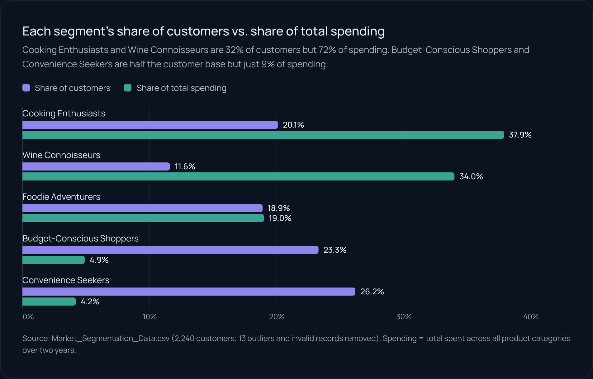
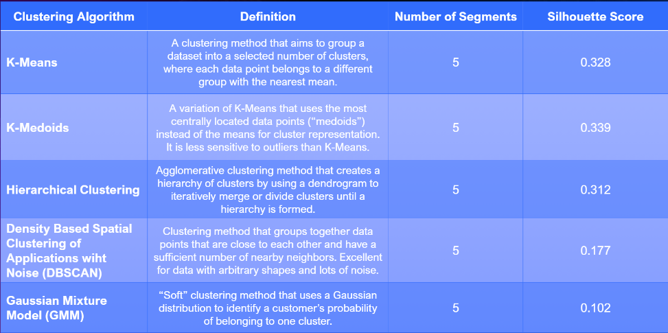
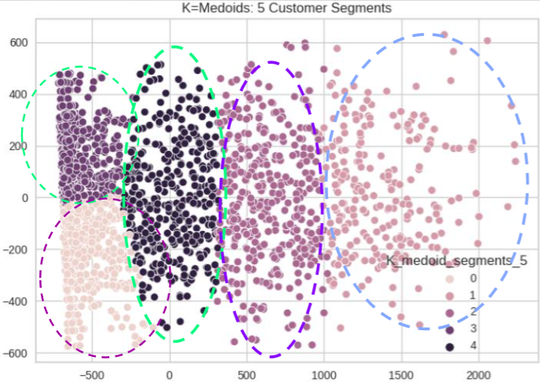
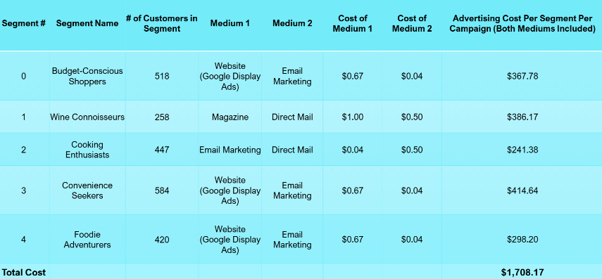
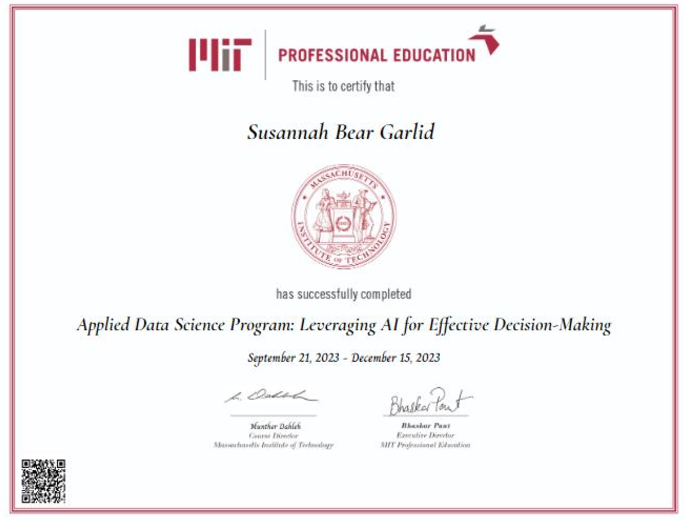

> **1 in 3 customers drives 72% of spending.** Five customer segments behave so differently that one campaign can't serve them all, so each gets its own message and channel, for $1,708 per campaign.
>
> **[View the one-page project summary →](https://garlid.github.io/Data-Projects-Portfolio/projects/market-segmentation.html)**

---

## Market Segmentation with K-Medoids

This folder contains the final submission for my capstone project for [MIT's Applied Data Science Program: Leveraging AI for Effective Decision-Making](https://professional-education-gl.mit.edu/mit-online-data-science-program). 

This project demonstrates my ability to:

1. Prepare Data  
2. Transform Data  
3. Engineer Data (feature engineering)  
4. Visualize Data  
5. Perform Statistical Analysis  
6. Select Appropriate Machine Learning Models For the Data  
7. Train The Selected Model(s)  
8. Test The Models  
9. Analyze Model Errors  
10. Communicate/Present Findings To Stakeholders  

---

### Table of Contents
1. [Files in This Folder](#files-in-this-folder)
2. [Key Findings](#key-findings)
3. [K-Medoids Cluster Output](#k-medoids-cluster-output)

---

### Files in This Folder

1. **Google Colab Notebook**:  
   - [`.ipynb` file](https://github.com/Garlid/Unsupervised-Machine-Learning/blob/main/Market_Segmentation_With_K-Medoids/Market_Segmentation_Google_Collab_Notebook.ipynb)  
   - [`.py` file](https://github.com/Garlid/Unsupervised-Machine-Learning/blob/main/Market_Segmentation_With_K-Medoids/Market_Segmentation_Python_Notebook)  
   - [PDF file](https://github.com/Garlid/Unsupervised-Machine-Learning/blob/main/Market_Segmentation_With_K-Medoids/Market_Segmentation_Notebook_PDF.pdf)  
     *(The PDF version is included in case of difficulty viewing the `.ipynb` file.)*

2. **Raw Data**:  
   - [Market Segmentation Data](https://github.com/Garlid/Unsupervised-Machine-Learning/blob/main/Market_Segmentation_With_K-Medoids/Market_Segmentation_Data.csv)

3. **Written Summary**:  
   - [Summary of Findings](https://github.com/Garlid/Unsupervised-Machine-Learning/blob/main/Market_Segmentation_With_K-Medoids/Market_Segmentation_Summary.pdf)

4. **Presentation**:  
   - [Delivered Presentation](https://github.com/Garlid/Unsupervised-Machine-Learning/blob/main/Market_Segmentation_With_K-Medoids/Market_Segmentation_Presentation.pdf)  
     *(Presented to a live audience on December 13, 2023.)*

---

### Key Findings

After analyzing the data and evaluating silhouette scores of various clustering algorithms, I recommend the **K-Medoids algorithm** for the following reasons:
- It achieved the **highest silhouette score** out of the 5 clustering algorithms tested.
- It is less sensitive to outliers, which was particularly important for this dataset as it contained a few outliers.

Below is a chart of the clustering performance metrics.

---

### K-Medoids Cluster Output

Here is a sneak peek at the output:

---

### Recomendations

Ultimately, I recommended customizing both marketing content and marketing medium (ie, mailers, emails, etc) for five customer segements:

1. Budget-Conscious Shoppers
2. Wine Connoisseurs
3. Cooking Enthusiasts
4. Convenience Seekers
5. Foodie Adventurers

Lastly, I identified the costs associated with advertising to these segments. The chart below depicts the costs. 

---

### MIT Professional Education Certificate

